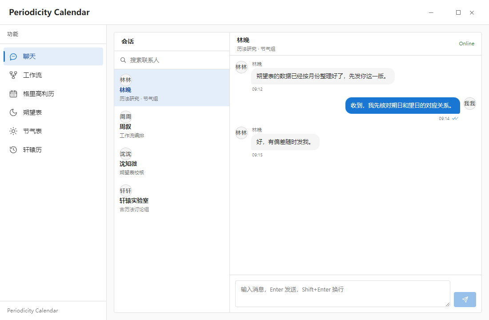

# periodicity-react 0.1.2 — three issues found while building a chat screen

Environment:

- `periodicity-react@0.1.2`
- `react@19.0.0`, `react-dom@19.0.0`
- Electron 30.5.1, Windows 10, Vite 5.4.21, TypeScript 6.0.3
- Theme: `<PeriodicityTheme theme="default" mode="light" density="compact">`
- Locale: `<PeriodicityInternational locale="zh-CN">`

The chat screen is composed as:

```tsx
<PeriodicityChat
    contacts={contacts}
    messages={messages}
    currentUser="我"
    contactsTitle="会话"
    contactsLabel="联系人"
    conversationLabel="当前会话"
/>
```

Attached screenshot (`periodicity-react-chat-bug.png`) shows all three issues together:



---

## Issue 1: Contact rows are stacked vertically because the Surface content wrapper is not flex

### Steps to reproduce

```tsx
<PeriodicityTheme theme="default" mode="light">
    <PeriodicityChat
        contacts={[
            { id: "lin", name: "林晚", description: "历法研究 · 节气组", presence: "online" },
        ]}
        messages={[]}
        currentUser="我"
    />
</PeriodicityTheme>
```

### Actual

Inside each contact row, the avatar, name/description block, and presence dot are stacked vertically. The row is much wider than its content, so the contact copy is compressed into a narrow column.

Measured DOM in the published build:

```text
.contact__row              display: flex, flex-direction: row, width: 259px
.contact__row > .surface__component
                           display: block, width: 86.17px, height: 63.19px
```

DOM shape:

```html
<div class="surface contact__row">
    <div class="surface__background"></div>
    <div class="surface__component">
        <span class="avatar">...</span>
        <span class="contact__copy">
            <span class="contact__name">林晚</span>
            <span class="contact__description">历法研究 · 节气组</span>
        </span>
        <span class="contact__presence"></span>
    </div>
    <div class="surface__foreground"></div>
</div>
```

`.contact__row` is flex, but its only content child is `.surface__component`, which is `display: block`. Therefore the row's `align-items`, `gap`, and horizontal layout do not apply to the avatar/copy/presence children.

### Expected

Avatar, contact copy, and presence dot should be laid out horizontally inside the row, with the copy taking the remaining width.

### Local workaround currently used

```css
.contact__row > .surface__component {
    display: flex;
    align-items: center;
    flex: auto;
    gap: var(--space-3);
    min-width: 0;
    width: 100%;
}
```

### Suggested fix

Add an equivalent rule to the Contact stylesheet, or render the row's slot content inside a flex wrapper rather than the default block `.surface__component`.

---

## Issue 2: Avatar initials duplicate the first CJK character

### Steps to reproduce

Use a contact without an `avatar` URL:

```tsx
<PeriodicityChat
    contacts={[{ id: "lin", name: "林晚" }]}
    messages={[]}
    currentUser="我"
/>
```

### Actual

The fallback avatar renders two identical characters:

- `林晚` → `林林`
- `周叙` → `周周`
- `沈知微` → `沈沈`
- `我` → `我我`

Published DOM:

```html
<span class="avatar__initials" aria-hidden="true">林林</span>
```

### Expected

For single-token/CJK names, use one character (`林`) or the full short name (`林晚`). For Latin names, first + last initial is fine. It should not repeat the first character.

### Suggested fix

Update the initials fallback to avoid duplicating the same character; add a regression test for CJK names and single-token names.

---

## Issue 3: Chat/Contact presence labels ignore the International locale

### Steps to reproduce

```tsx
<PeriodicityInternational locale="zh-CN">
    <PeriodicityChat
        contacts={[{ id: "lin", name: "林晚", presence: "online" }]}
        messages={[]}
        currentUser="我"
    />
</PeriodicityInternational>
```

### Actual

The conversation header shows the raw English value `Online`. The contact presence dot also exposes the raw `aria-label="online"`.

### Expected

The presence label and accessible name should use the active locale dictionary, e.g. `在线` for `online` under `zh-CN`.

### Cause

The published Chat implementation renders the raw presence value:

```ts
Z.presence ?? V("offline")
```

The Contact presence dot likewise uses the raw presence value as its `aria-label`.

### Suggested fix

Map `online | away | busy | offline` through the International messages before rendering, and use the localized label for the presence dot's accessible name.

---

## Proposed issue titles

1. `Contact rows stack vertically because .surface__component is not flex`
2. `Avatar initials duplicate the first CJK character`
3. `Chat/Contact presence labels are not localized by International`

If a single issue is preferred, use:

**`Contact/Chat rendering and localization issues in 0.1.2 (row layout, CJK avatar initials, presence labels)`**
